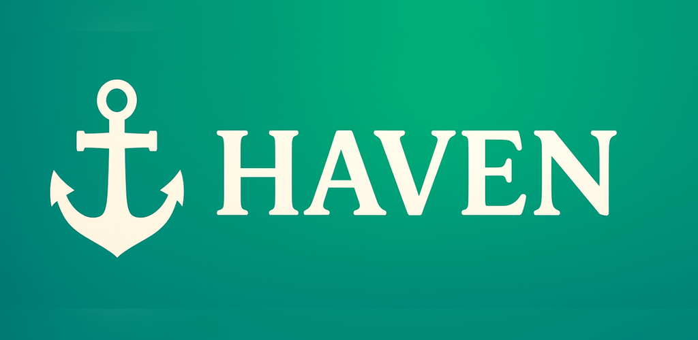

<p align="center">
  
</p>

Haven for Android is the companion app to [Haven Desktop](https://github.com/Haven-Organization/haven-desktop).
It is a Matrix client built on [Element X Android](https://github.com/element-hq/element-x-android) that brings in
everything from [SchildiChat Next](https://github.com/SchildiChat/schildichat-android-next), including the
**Turtle Tweaks** settings. See [FEATURES.md](FEATURES.md) for what SchildiChat adds on top of Element X.

Try Haven on the web at https://app.haven.software

## How this repository is put together

- `origin` is [element-hq/element-x-android](https://github.com/element-hq/element-x-android). Haven tracks its
  **latest release tag** (currently `v26.11.0`).
- `schildichat` is [SchildiChat/schildichat-android-next](https://github.com/SchildiChat/schildichat-android-next),
  merged in with its full history so later merges stay incremental.
- Haven's own changes (branding, servers, SDK compatibility) are separate commits on top.

SchildiChat code lives mostly in `chat.schildi.*` packages and the `schildi/` modules, with `// SC` markers in
Element files. Haven changes use `// Haven` markers.

### Rust SDK

Most SchildiChat features need SchildiChat's fork of the Matrix Rust SDK (`chat.schildi.rustcomponents`, served
from `maven.spiritcroc.de`), so Haven uses it instead of `org.matrix.rustcomponents`. When Element X needs newer SDK
APIs than the fork has, they're shimmed in
`libraries/matrix/impl/src/main/kotlin/io/element/android/libraries/matrix/impl/compat/HavenSdkCompat.kt` or marked
`Haven: SDK compat`. Drop those shims once the fork catches up.

## Updating from upstream

```sh
git fetch origin --tags && git fetch schildichat
git merge vXX.YY.Z            # new Element X release tag
git merge schildichat/main    # when SchildiChat has new changes
./fix_merge.sh                # drops LFS screenshots, takes upstream translations, re-applies Haven names
```

`correct_strings.sh` (run by `fix_merge.sh`) rewrites "Element"/"SchildiChat" to "Haven" in the generated
translation files, keeping names like Element Call. Don't edit `localazy.xml` by hand; rerun the script instead.

## Building

Builds work like Element X: JDK 21 and the Android SDK (platform 37). Only the F-Droid flavours are enabled:

```sh
./gradlew assembleFdroidScDefaultDebug
```

| Variant  | Application ID                    | Launcher name |
|----------|-----------------------------------|---------------|
| default  | `software.haven.android`          | Haven         |
| beta     | `software.haven.android.beta`     | Haven β       |
| internal | `software.haven.android.internal` | Haven[i]      |

Debug builds add `.debug` to the ID and use an amber launcher icon.

## Notifications and bug reports

Haven doesn't run push or rageshake servers yet:

- Push uses [UnifiedPush](https://unifiedpush.org/users/distributors/) with the public
  `matrix.gateway.unifiedpush.org` gateway. Install a distributor such as ntfy to receive notifications.
  SchildiChat's built-in FCM distributor is disabled, because it relays through SchildiChat's own servers.
- Bug reporting is hidden (`RageshakeConfig.BUG_REPORT_URL` is empty).

## Branding

Icons are generated from Haven Desktop's `assets/logo.svg` (the anchor), with brand colours `#5bd699`,
`#105c64` and `#f7f1de`. The launcher, monochrome and notification icons are vector drawables in
`app/src/sc/res` and `libraries/designsystem/src/sc/res`.

## License

AGPL-3.0, like Element X and SchildiChat. See [LICENSE](LICENSE).
